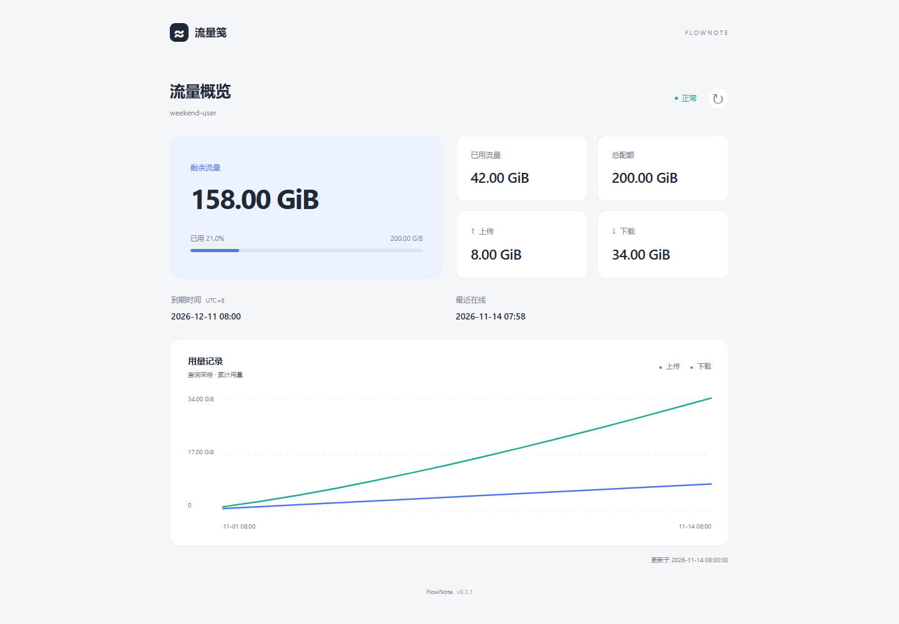

<div align="center">


# FlowNote

**Connect your node. Open a link. Know your traffic balance.**

A lightweight HTTPS traffic dashboard for people sharing a 3x-ui server through individual accounts.
No panel subscription service or end-user login required.

[](https://github.com/youbilin/FlowNote/actions/workflows/ci.yml)
[](CHANGELOG.md)
[](LICENSE)

[简体中文](README.md) · **English**

</div>

> [!IMPORTANT]
> **Early software: validate with two real accounts before deployment.** Identity is inferred by correlating Xray source addresses with access logs. Mux, CDN frontends, and shared underlying connections are unsupported. Local simulated integration tests have passed; real 3x-ui / Xray deployment has not yet been verified. HTTPS does not fix an incorrect identity association.

## At a glance



*All screenshots use synthetic data. The dashboard UI is currently in Chinese; this English README is a documentation translation, not a claim of UI localization.*

- **The numbers that matter:** remaining and used traffic, quota, uploads, downloads, expiry, and last online time.
- **No subscription dependency:** users connect their own node and open a dedicated URL. Administrators configure a panel API token.
- **Native HTTPS:** PROXY protocol is read before TLS; SNI and Host must match the configured domain.
- **Quiet frontend:** responsive layouts, system dark mode, no JavaScript, external fonts, analytics, cookies, or browser storage.
- **Composable outputs:** HTML, text, and JSON; GET and HEAD.
- **Bounded backend:** timeouts, concurrency limits, short-lived cache, response size limits, and rejection of observed identity conflicts.

## Requirements

1. A Linux VPS with FlowNote and Xray on the same host and network namespace.
2. A 3x-ui version supporting API tokens and `GET /panel/api/clients/traffic/{email}`. Panel subscriptions may remain disabled.
3. Your own dedicated domain and a valid certificate. DNS-01 renewal is recommended; do not put the query endpoint behind a CDN.
4. Proxy routing that preserves the query domain, enabled access logs, and a unique client email label. Disable Mux for this topology.

## Get started

On a Linux amd64 / arm64 host with systemd, install the prebuilt static musl package without a Rust toolchain:

```bash
curl --proto '=https' --tlsv1.2 -fsSL https://github.com/youbilin/FlowNote/releases/download/v0.3.1/install.sh | sudo bash -s -- --version v0.3.1
```

The installer selects the native architecture, verifies the release checksum, archive layout and binary version, and installs the service account and systemd unit. Existing configuration, tokens and certificates are preserved. A new service waits for configuration before its first start; an active service is restarted on upgrade, with a previous binary retained for rollback.

To inspect the script first or download an offline package:

```bash
curl --proto '=https' --tlsv1.2 -fsSL -o install.sh https://github.com/youbilin/FlowNote/releases/download/v0.3.1/install.sh
less install.sh
sudo bash install.sh --version v0.3.1
# Download and verify without installing:
bash install.sh --download-only ./flownote-download
```

[Release packages and SHA256SUMS](https://github.com/youbilin/FlowNote/releases/tag/v0.3.1). Checksums detect corruption and are not independent signatures. Source builds remain available with `cargo build --release --locked`.


Follow the [deployment guide](docs/DEPLOYMENT.md) to create a dedicated service user, install certificates and token files, and configure [`config.example.toml`](deploy/config.example.toml), the [Xray routing snippet](deploy/xray-snippet.json), and the [systemd unit](deploy/flownote.service). The detailed deployment guide is currently in Chinese.

The panel-only check prints one account's traffic and exits without starting a listener:

```bash
sudo -u flownote /usr/local/bin/flownote /etc/flownote/config.toml   --check-panel 'your-client-email'
```

After deployment and two-account validation, users connect their node and open `https://traffic.your-domain/`.

Terminal queries must use the corresponding proxy too. Replace the example domain and local port:

```bash
curl --proxy socks5h://127.0.0.1:1080 https://traffic.example.com/
curl --proxy socks5h://127.0.0.1:1080 https://traffic.example.com/json
```

### Preview without a panel

```bash
cargo run --locked -- --preview output/preview
```

Open `output/preview/index.html` locally. Nine synthetic state pages are generated, including low balance, exhausted, expired, disabled, unlimited, pending activation, 403, and 502. No configuration, token, certificate, network service, or panel connection is needed.

## Connection model

```text
Browser → HTTPS through its node → Xray → dedicated freedom outbound
                                              ↓ PROXY header + TLS
                                     FlowNote on 127.0.0.1:8686
                                      ↙                    ↘
                       source-to-email log index      3x-ui traffic API
```

Identity comes from server-side log correlation. Request parameters, cookies, and forwarded headers cannot select another account. A mismatched upstream email or an observed source conflict is rejected.

**Keep port 8686 on loopback.** Do not publish it, DNAT it, or place it behind a conventional HTTP reverse proxy. PROXY headers are unauthenticated; untrusted local processes are outside this deployment's trust boundary.

## Compatibility and limits

| Scenario | Status |
| --- | --- |
| Single VPS, colocated Xray, non-multiplexed connections | Intended topology; real deployment acceptance tests still required |
| IPv4 / IPv6 and PROXY v1 / v2 | Parser and unit test coverage |
| Panel subscription disabled | Supported |
| API-token-capable panel | Required; actual endpoint permissions depend on the installed panel |
| Mux / CDN / shared underlying connections | Unsupported |
| Remote panel | Validated HTTPS only; loopback HTTP is allowed |
| Account blocked by Xray after expiry or exhaustion | Dashboard access cannot be guaranteed |
| Multi-VPS aggregation, groups, notifications | Out of scope |

This release moves directly from the v0.1 prototype to v0.3, skips v0.2, and does not plan v0.4.

## Development

```bash
cargo fmt --check
cargo clippy --locked -- -D warnings
cargo test --locked
cargo build --locked
python3 tests/e2e.py target/debug/flownote
```

Local validation: **33 unit tests, 35 TLS / PROXY integration checks, and 8 offline installer test groups passed**. Integration tests use a temporary local certificate and simulated panel/logs; they do not constitute real Xray verification. See [test notes](docs/TESTING.md), [architecture](docs/DESIGN.md), and [UI design](docs/UI.md).

Contributions are welcome. Read [CONTRIBUTING.md](CONTRIBUTING.md) and report potential data exposure privately using [SECURITY.md](SECURITY.md). Never post real API tokens, access logs, or user traffic records.

## License

[MIT](LICENSE) © 2026 You Bilin. An independent project, not affiliated with 3x-ui or Xray.

## Query history

The compact dashboard shows remaining traffic, used traffic, uploads, downloads, quota, expiry and status. Optional server-side history stores actual cumulative counters observed during user queries and renders an inline SVG curve. It does not reconstruct past usage or provide precise daily billing. New installation templates enable 30-day retention with hourly sampling; legacy configurations keep history disabled. Cache hits reuse the original fetch timestamp, and counter resets break the curve. Account files use SHA-256 names with restricted filesystem permissions; they are not encrypted. See [history and deletion](docs/DEPLOYMENT.md#历史曲线与数据保留).
