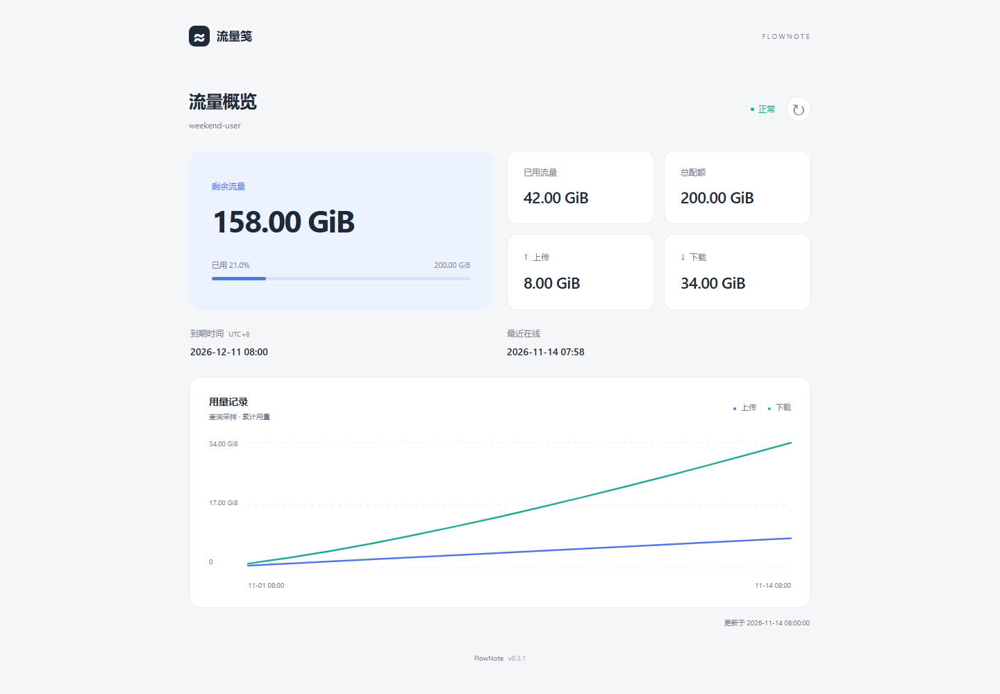
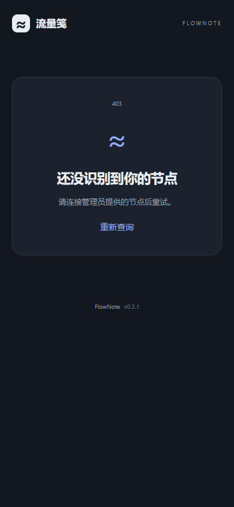

<div align="center">


# FlowNote · 流量笺

**连接你的节点，打开一个链接，流量与有效期一目了然。**

面向 3x-ui 拼节点用户的轻量流量查询页。无需开启面板订阅，无需用户登录。

[](https://github.com/youbilin/FlowNote/actions/workflows/ci.yml)
[](CHANGELOG.md)
[](Cargo.toml)
[](LICENSE)

**简体中文** · [English](README.en.md)

[界面预览](#界面预览) · [快速开始](#快速开始) · [部署指南](docs/DEPLOYMENT.md) · [设计文档](docs/DESIGN.md) · [反馈问题](https://github.com/youbilin/FlowNote/issues)

</div>

---

## 为什么做 FlowNote

“还剩多少流量？什么时候到期？”对于共用一台服务器、分别拥有独立账号的用户，这两个问题不应该需要进入管理面板，也不应该要求把账号凭据交给一个查询网站。

FlowNote 提供一张只读的流量手记：用户先连接管理员分配的节点，再打开专用查询链接。服务通过 Xray 的连接来源与访问日志关联当前账号，从面板读取对应统计，展示剩余流量、配额与有效期。**不依赖面板订阅功能，也不需要在页面填写账号、UUID 或订阅链接。**

> [!IMPORTANT]
> **v0.3 为早期版本，上线前需要真实双账号验收。** 来源与日志的关联依赖部署拓扑，不支持 Mux、CDN 或多个账号共享底层连接的场景。已通过本地模拟集成测试，尚未完成真实 3x-ui / Xray 环境验证。详见[支持范围](#支持范围)和[安全边界](docs/DESIGN.md#2-数据链路与身份边界)。

## 界面预览

<p align="center">
  
</p>

<details>
<summary><strong>查看手机、深色模式与错误页</strong></summary>
<br />
<table>
<tr>
<td align="center" width="33%"><strong>手机浅色</strong><br /></td>
<td align="center" width="33%"><strong>手机深色</strong><br /></td>
<td align="center" width="33%"><strong>无法识别时</strong><br /></td>
</tr>
</table>
</details>

*截图和日期曲线使用合成账号与流量数据；实际曲线从启用采样后逐步积累。查询页没有第三方资源；GitHub 文档中的徽章由 GitHub / Shields.io 提供。*

## 功能一览

| 能力 | 说明 |
| --- | --- |
| 看清余量 | 剩余、已用、总配额、上传、下载，以及直观的用量进度 |
| 日期曲线 | 可选保存查询时的累计上传 / 下载，按实际时间绘制；不回填历史、不冒充每日账单 |
| 便捷安装 | Linux amd64 / arm64 静态安装包、校验清单和安装脚本；附交互式配置菜单，自动检测本机 3x-ui |
| 看清有效期 | 到期时间、时区、最近在线；正确区分无限套餐与首次使用计时 |
| 状态有反馈 | 正常、低流量、用尽、过期、停用及友好错误页 |
| HTTP / HTTPS 入口 | 默认 `http://6.6.6.6/`，也兼容自有域名 HTTPS |
| 少一步操作 | 用户无需登录、无需启用面板订阅；管理员配置面板 API Token |
| 适配日常使用 | 手机与桌面响应式布局、系统深色模式、键盘焦点 |
| 输出可组合 | HTML、纯文本和 JSON；提供 `GET` / `HEAD` |
| 克制的前端 | 服务端渲染，无 JavaScript、无外部字体、无统计脚本、无浏览器存储 |
| 有界服务 | 并发与超时限制、短期缓存、响应大小限制；已观察到来源冲突时拒绝返回数据 |

<a id="快速开始"></a>

## 快速开始：使用 http://6.6.6.6/

**不需要买域名、不需要 DNS 解析、不需要证书，也不需要开启面板订阅。** 管理员在服务器配置一次，普通用户连接自己的节点，打开 **`http://6.6.6.6/`** 即可查看自己的流量。

这里的 `6.6.6.6` 是约定的查询入口。它是一个真实公网 IP，并不属于本项目；必须由客户端送入节点，再由服务器 Xray 精确截获。**不向这个 IP 的真实主机发起查询，不把它绑定到网卡，也不把它指向 VPS。**

```text
浏览器 http://6.6.6.6/
  → 本地代理：6.6.6.6/32 走自己的节点
  → 服务器 Xray：6.6.6.6 TCP 80 → traffic-query 出站
  → freedom：PROXY v2 + HTTP → 127.0.0.1:8686
  → FlowNote：关联 access.log 中的账号 → 面板 API → 当前账号流量
```

### 1. 确认环境

- Linux VPS，有 systemd；已运行 3x-ui 和 Xray。
- FlowNote 与 Xray 在同一主机、**同一网络命名空间**。下面按直接安装讲解；Docker 内的 `127.0.0.1` 不是宿主机回环，请先处理容器网络。
- 面板支持 API Token 和 `GET /panel/api/clients/traffic/{email}`。API 与订阅功能独立；没有此接口时，需要先确认面板兼容性。
- 每个用户有唯一的 client email 标签；查询连接禁用 Mux、多账号共享底层连接，以及会合并来源的 CDN / 反向代理。客户端选择实际要查的账号节点。

### 2. 一键安装并打开交互式菜单（推荐）

支持 **Linux amd64 / arm64**，自动识别架构，使用预编译静态二进制，不需要在 VPS 上编译 Rust：

```bash
curl --proto '=https' --tlsv1.2 -fsSL https://github.com/youbilin/FlowNote/releases/download/v0.3.4/install.sh | sudo bash -s -- --version v0.3.4 --setup
```

安装脚本下载固定版本、校验 SHA-256、包内路径和二进制版本，安装程序与 systemd 服务后打开配置菜单。**需要 Python 3（仅使用标准库）；缺少时先执行 `sudo apt-get install -y python3`。** 单独安装不改 Xray；选择菜单配置并确认后，才会合并查询路由并启动服务。安装或升级保留已有配置和数据；活动服务升级会短暂重启，向导应用配置时另有备份与确认。

想先审阅脚本，或只下载离线包：

```bash
curl --proto '=https' --tlsv1.2 -fsSL -o install.sh https://github.com/youbilin/FlowNote/releases/download/v0.3.4/install.sh
less install.sh
sudo bash install.sh --version v0.3.4 --setup
# 只下载并校验，不安装：
bash install.sh --version v0.3.4 --download-only ./flownote-download
```

[预编译包及 SHA256SUMS](https://github.com/youbilin/FlowNote/releases/tag/v0.3.4)。清单用于发现下载损坏，不是独立签名。

### 交互式配置：已经安装 3x-ui，直接用菜单

已有 FlowNote 也可以运行上面的安装命令升级，然后随时打开：

```bash
sudo flownote-setup
```

```text
流量笺 · FlowNote
  1. 检测 3x-ui 安装
  2. 配置 HTTP 查询入口
  3. 查看服务状态与日志
  4. 显示客户端分流规则
  5. 卸载与清理
  0. 退出
```

**按官方脚本安装 3x-ui 的服务器，通常选择 `2` 即可。** 向导从本机设置读取实际端口和访问路径，不会把面板端口写死成 2053。

| 检测项 | 默认位置 / 处理 |
| --- | --- |
| 面板目录 | `/usr/local/x-ui` |
| 面板数据库 | `/etc/x-ui/x-ui.db`，只读取必要设置 |
| Xray 内核 | 自动识别 `/usr/local/x-ui/bin/` 中的架构对应可执行文件 |
| 面板地址 | 从 SQLite 读取实际端口、访问路径；面板启用 HTTPS 时要求输入证书可验证的实际地址 |
| 访问日志 | 优先使用已有绝对路径；未配置时建议 `/var/log/flownote-xray/access.log` |

按提示确认面板地址和日志位置，然后粘贴 **API Token（输入不回显）**，填写一个**真实 client email** 用于核对流量接口权限。Token 是面板 API 凭据，不是登录密码、UUID 或订阅链接；已有 Token 可留空保留。无需开启订阅。

若提示“未找到持久化 Xray 模板”，先在面板的 **Xray 设置 / 配置** 页保存一次现有配置，再重新运行。向导不会拿面板生成的运行时 `config.json` 覆盖持久化模板。

确认前会检查 Xray 候选配置并显示变更。输入 `y` 后先验证面板接口，再备份并修改数据库中的 Xray 模板这一项，合并专用出站与路由，设置日志权限，启动 FlowNote。原节点、默认出站、面板登录与订阅开关保留；**应用期间 x-ui 会短暂重启，连接可能中断。** 向导生成 HTTP / 历史采样配置，已有 FlowNote 自定义配置会先备份。原日志的地址掩码会关闭，以保留关联账号所需的完整来源 IP:端口。

备份在 `/var/backups/flownote/<时间-随机后缀>/`，仅 root 可读，包含原数据库及已有的 FlowNote 配置 / Token。失败时尝试只恢复 Xray 模板与 FlowNote 配置，不用整库回滚流量统计；已创建的日志文件、ACL 或轮转配置可能保留。备份含敏感信息，请勿上传公开仓库。

默认专用日志会生成 `/etc/logrotate.d/flownote-xray`；系统需安装 `logrotate` 才会执行轮转（Debian / Ubuntu：`sudo apt-get install -y logrotate`）。选择已有日志时须自行让轮转后的文件继续可读；需要补 ACL 的环境先安装 `acl`。日志不能放在受服务 `ProtectHome` 限制的 `/root` 或 `/home` 下。

**向导成功后，跳到第 6 步配置自己的客户端，再完成第 8 步查询和第 9 步双账号验收。第 3、4、5、7 步是手动配置的备用方式，不必重复执行。**

只读检测，或指定自定义安装位置：

```bash
sudo flownote-setup --detect
sudo flownote-setup --xui-dir /实际面板目录 --db /实际目录/x-ui.db --core /实际目录/xray
```

自动配置支持本机 systemd `x-ui` 服务与 SQLite；会核对运行中的面板路径、数据库目录和网络命名空间。Docker、PostgreSQL、远程面板或其他非标准部署请按下面的手动方式配置；已有 HTTPS 查询配置请先人工检查，向导不会覆盖冲突的同名出站。

### 卸载与清理

运行 `sudo flownote-setup`，选择 **`5. 卸载与清理`**。旧版本没有这个菜单时，先用上面的安装命令升级到 v0.3.4。

```text
卸载与清理
  1. 卸载程序，保留配置、Token、历史数据和备份
  2. 完全清理（同时删除上述数据及可安全移除的专用日志）
  0. 返回
```

- **选 1，输入 `UNINSTALL`**：停止并禁用服务，移除程序、菜单、systemd 单元及专用 drop-in 目录；保留配置、Token、证书、历史、日志、服务账号与备份，方便重装。
- **选 2，输入 `DELETE`**：另行永久删除 `/etc/flownote/`、`/var/lib/flownote/`、`/var/backups/flownote/`，包含 Token、证书、历史采样和所有备份。可安全移除时还会清理专用日志目录、轮转配置及标准服务账号。删除无法撤销。

两种方式都会先核对持久化 Xray 模板，只移除匹配向导的查询出站和路由；3x-ui、现有节点、面板登录及流量统计保留。若原安装备份仍可核对，只恢复未被另行修改的日志路径 / 地址掩码设置；不覆盖其他新设置。Xray 配置检查或重启失败时尝试回退，保留 FlowNote 文件。自定义出站、HTTPS 查询路由、其他配置仍引用查询标签时会停止，需先人工处理。

**先在客户端移除 `6.6.6.6` 分流规则。** Xray 配置变更会短暂重启 x-ui；卸载后在面板撤销不用的 API Token。自定义目录、共享 Xray 日志及其 ACL、系统 journal 不会自动删除。无法核对原日志设置且 Xray 仍使用 `/var/log/flownote-xray/` 时，即使选完全清理也会保留该日志、轮转配置和服务账号，并明确提示。

### 3. 手动配置备用：填写面板 Token 和服务配置

在面板中创建有流量查询权限的 API Token。下面通过编辑器保存，避免把真实 Token 放入命令历史：

```bash
sudo touch /etc/flownote/token
sudo chown root:flownote /etc/flownote/token
sudo chmod 640 /etc/flownote/token
sudo nano /etc/flownote/token
sudo nano /etc/flownote/config.toml
```

`token` 文件只放 Token 本身，不加 `Bearer `、引号或 TOML 字段。`config.toml` 的完整 HTTP 示例：

```toml
[server]
listen = "127.0.0.1:8686"
protocol = "http"
domain = "6.6.6.6"
max_conns = 128

[xray]
access_log = "/usr/local/x-ui/access.log"
outbound_tag = "traffic-query"
lookup_timeout_ms = 1500
entry_ttl_secs = 600

[panel]
base_url = "http://127.0.0.1:2053"
token_file = "/etc/flownote/token"
cache_ttl_secs = 5
timeout_secs = 5

[display]
title = "流量笺"
tz_offset_hours = 8

[history]
enabled = true
directory = "/var/lib/flownote/history"
retention_days = 30
sample_interval_secs = 3600
```

需要按实际环境修改 **面板端口、面板路径、日志路径和 Token**。例如面板登录地址是 `http://127.0.0.1:2053/my-secret-path/`，则 `base_url = "http://127.0.0.1:2053/my-secret-path"`，不要再拼 `/panel/api`。远程面板必须使用正常验证证书的 HTTPS；本机回环面板可用 HTTP。

`domain` 在 HTTP 模式表示允许的 Host，直接保留 `6.6.6.6`，**不带 `http://`、端口或斜杠**。HTTP 配置不添加 `[tls]`。`listen` 保留回环地址；不要开放或转发公网 8686，也不需要在 VPS 公网监听 80。

### 4. 开启 Xray 访问日志，并赋予读取权限

在 3x-ui 的 **Xray 配置** 中合并日志设置；面板菜单名称随版本变化，日志路径必须与上一步一致：

```json
"log": {
  "access": "/usr/local/x-ui/access.log",
  "loglevel": "warning"
}
```

保留已有 error 等配置。保存并重启 Xray 后，确认日志实际生成。FlowNote 服务用户需要能穿过父目录并读取该文件。以这个路径为例，Debian / Ubuntu 可安装 ACL 工具后授权：

```bash
sudo apt-get update
sudo apt-get install -y acl
sudo setfacl -m u:flownote:--x /usr/local/x-ui
sudo setfacl -m u:flownote:r-- /usr/local/x-ui/access.log
sudo -u flownote test -r /usr/local/x-ui/access.log && echo 'access log readable'
```

路径不存在时先检查 Xray 的实际日志位置及写入权限；使用其他目录时相应替换。若仍不可读，用 `namei -l /usr/local/x-ui/access.log` 检查各级父目录。**只给专用日志文件读取权限，不要递归开放整个面板目录。** 日志轮转后要对新文件保留相同权限，例如在实际 logrotate 配置的 `postrotate` 中对该日志重新执行 `setfacl -m u:flownote:r-- ...`。不要给包含面板数据库的目录设置宽泛的默认读取 ACL。

日志应包含查询连接的来源 `IP:端口`、出站标签 `traffic-query` 和 `email`。没有唯一的 email，FlowNote 会拒绝返回账号数据。

### 5. 合并 Xray 出站和路由

下面是要合并的部分，**不是完整配置**。先备份当前 Xray 配置，在面板管理的持久化配置位置修改；不要直接用片段覆盖整个文件，避免丢失已有节点。

在现有 `outbounds` 数组**末尾追加**：

```json
{
  "tag": "traffic-query",
  "protocol": "freedom",
  "settings": {
    "redirect": "127.0.0.1:8686",
    "proxyProtocol": 2
  }
}
```

若原来没有名为 `block` 的出站，再追加一个：

```json
{"tag": "block", "protocol": "blackhole", "settings": {}}
```

保留原本的默认出站位置，不要把 `traffic-query` 放到出站数组第一项。然后把以下两条**按此顺序放到 `routing.rules` 数组最前面**，位于直连、私网拦截、广告拦截和其他兜底规则之前：

```json
[
  {
    "type": "field",
    "network": "tcp",
    "ip": ["6.6.6.6/32"],
    "port": "80",
    "outboundTag": "traffic-query"
  },
  {
    "type": "field",
    "network": "tcp,udp",
    "ip": ["6.6.6.6/32"],
    "outboundTag": "block"
  }
]
```

第一条只把目标 `6.6.6.6:80` 的 TCP 请求转入 FlowNote。第二条阻止这个入口的其他端口和 UDP 流量在服务器端误连真实地址；因此 **`https://6.6.6.6/` 不提供服务**。不要写成将所有 80 端口流量都转进来。

完整可合并片段见 [`deploy/xray-snippet.json`](deploy/xray-snippet.json)，安装后也在 `/usr/local/share/flownote/xray-snippet.json`。片段中的说明字段和 `outbounds_append` / `routing_rules_insert_first` 是合并提示，不能原样作为 Xray 顶层字段保存。

某些新版 Xray 的 freedom 会在最终拨号阶段默认拦截私网地址。如果日志提示 `127.0.0.1:8686` 被拦截，且你的版本支持 `finalRules`，仅在 **traffic-query 的 `settings`** 里额外加入：

```json
"finalRules": [
  {"action": "allow", "network": "tcp", "ip": ["127.0.0.1"], "port": "8686"}
]
```

旧版不认识此字段时不添加；以 Xray 配置检查与启动日志为准。不要全局放开私网。字段语义见 [Xray freedom 官方文档](https://xtls.github.io/config/outbounds/freedom.html)。

保存后重启 Xray，确认原有节点仍能正常连接；后续面板更新配置时也要保留这些规则。

### 6. 客户端分流：让入口走自己的节点

**Clash / Mihomo**：在实际生效配置的 `rules` 最前面加入以下规则，或使用客户端的覆写 / 扩展规则功能，避免订阅更新覆盖：

```yaml
rules:
  - IP-CIDR,6.6.6.6/32,你的节点或策略组,no-resolve
  # 原有规则继续放在后面
```

将 `你的节点或策略组` 替换为真实名称。若用策略组，组内选择这台服务器上、属于你自己的账号节点；不要选 `DIRECT`，也不要用混有不同账号的随机或负载均衡组。使用规则模式，并确保浏览器已被**系统代理、TUN 或浏览器代理**接管。只有写规则、没有让浏览器走代理，仍然无效。

**其他客户端**：配置同样的目标规则：`6.6.6.6/32 → 自己的节点`，并确认优先级高于直连规则。如果客户端没有规则编辑功能，可以先让全部浏览器流量通过指定节点验证，再按其支持方式添加精确规则。

不需要改 DNS、hosts 或 Fake-IP 映射。此入口使用 IPv4 字面量，关键是代理是否接管请求、是否选对节点。跨账号 Mux / 连接复用必须关闭。

### 7. 验证面板并启动服务

先用该节点实际配置的 email 验证面板权限；这个命令直接在服务器查询面板，执行后退出，不经过浏览器或 Xray：

```bash
sudo -u flownote /usr/local/bin/flownote /etc/flownote/config.toml --check-panel '真实的-client-email'
sudo systemctl enable --now flownote
sudo systemctl status flownote --no-pager
sudo journalctl -u flownote -n 50 --no-pager
sudo ss -lntp | grep ':8686'
```

监听应为 `127.0.0.1:8686`。普通 `curl http://127.0.0.1:8686/` 会被拒绝，因为该端口要求 Xray 提供 PROXY 头，不能用它代替经过节点的完整验收。

### 8. 用户打开页面

连接自己的节点，在浏览器地址栏输入完整地址：

```text
http://6.6.6.6/
```

成功后只显示流量数字、上传、下载、总配额、有效期、状态和已有的历史曲线。无需登录、填写账号、提供订阅链接或面板 Token。浏览器可能显示“不安全”，因为这里使用 HTTP；若浏览器自动升级到 HTTPS，需为这个地址允许 HTTP 或关闭该站点的 HTTPS 自动升级。

在**用户电脑**上也可通过本地 SOCKS 代理检查；下面 `7891` 只是示例端口，换成客户端实际 SOCKS 端口：

```bash
curl --proxy socks5h://127.0.0.1:7891 'http://6.6.6.6/?format=text'
curl --proxy socks5h://127.0.0.1:7891 'http://6.6.6.6/json'
```

### 9. 交给其他用户前，做双账号验收

用两个有不同流量的真实账号 A / B，分别经各自节点访问同一个入口，核对账号、上传下载、配额和有效期与面板一致。再检查同一 Wi-Fi / NAT 下两账号并发、断线重连及 access log 轮转后的结果。切换账号时也要切换实际节点连接，避免复用旧连接。

来源无法识别应返回 403；上游查询异常返回 502；出现串号就先停止对外提供查询，检查 Mux、共享来源和日志关联。现有自动化测试模拟面板、日志和 PROXY 发送端，不能替代目标服务器上的真实 Xray 联调。

### HTTP 的保护范围

HTTP 本身没有网站身份验证或防篡改保护。若浏览器请求完整进入已认证、加密的节点隧道，并在服务器内通过回环到 FlowNote，中间运营商和公共 Wi-Fi 无法直接读取或篡改隧道内内容；但错误直连、浏览器到局域网代理之间的明文链路、失陷的节点仍有风险。它不等同于浏览器到 FlowNote 的独立 HTTPS 保护。

本方案不向用户下发面板 Token / UUID / subId，响应禁止缓存，8686 只在回环监听。仍需信任本机进程与节点管理员；这些措施不能给 HTTP 增加 TLS。

## 常见问题

| 现象 | 检查位置 |
| --- | --- |
| 超时、连接失败、打开其他网页 | 浏览器是否被代理接管；客户端是否 `DIRECT`；Xray 精确规则是否排在前面；FlowNote 是否启动 |
| `https://6.6.6.6/` 打不开 | 使用完整 `http://6.6.6.6/`；检查浏览器 HTTPS 自动升级 |
| 403 / 还没识别到节点 | access log 路径、读取权限、email、traffic-query 标签；关闭 Mux / 共享来源；确认查的是正确节点 |
| 421 / 入口地址不正确 | `server.domain` 应为 `6.6.6.6`，不附协议、端口、路径；请求 Host 必须匹配 |
| 502 / 数据暂时没有送达 | 运行 `--check-panel`；核对 Token 权限、端口、webBasePath 和 API 兼容性 |
| Xray 报私网目标被阻止 | 查看本版本 freedom 的 `finalRules` 支持；只对查询出站放行本机 8686 |
| 服务启动失败 | `journalctl -u flownote`；HTTP 使用 `protocol = "http"` 并移除 `[tls]` |
| 安装升级后仍要求证书 | 安装脚本保留旧配置；按本 README 手动迁移，不能只改浏览器地址 |
| 日志轮转后无法识别 | 新日志是否仍可读、父目录能否进入；修正轮转创建权限或 scoped ACL hook |
| 曲线为空或只有一个点 | 查询时才采样；积累至少两个不同时间点才有趋势，没有过去的每日账单 |
| 用户已过期 / 停用后无法查询 | 如果 Xray 已拒绝该账号建立连接，此入口也可能无法访问 |

## 历史曲线

默认保留 30 天的查询采样，通常每小时最多新增一个点。曲线显示**按查询时间观察到的累计上传 / 下载**，不是后台定时采集的每日用量；不会回填安装前的数据。计数下降时记录重置点并断开折线。`retention_days` 可设 1–90，采样间隔 300–86400 秒；不需要曲线时设置 `history.enabled = false`。

数据保存在 `/var/lib/flownote/history`，按账号散列文件名隔离，只含时间、上传、下载。清理由有效查询触发，停止服务后不会自动清理；清空历史前先停止服务，再删除该目录下的采样文件并恢复服务。详细资源限制见[架构设计](docs/DESIGN.md)。

## HTTPS 兼容与升级

已有 HTTPS 部署继续可用，旧配置不写 `server.protocol` 时仍默认 HTTPS。模板见 [`config.https.example.toml`](deploy/config.https.example.toml) 和 [`xray-https-snippet.json`](deploy/xray-https-snippet.json)。HTTPS 需要自有域名及浏览器信任的证书；可通过 DNS-01 取得证书，无需把查询域名的 A / AAAA 记录指向 VPS。分流仍须将该域名送进对应节点。

从 HTTPS 切到本方案：备份配置 → 设置 `protocol = "http"`、`domain = "6.6.6.6"` → 移除 `[tls]` → 更换服务端路由与客户端规则 → 重启 FlowNote / Xray → 双账号验收。修改配置前先安装支持此模式的 **v0.3.2 或更新版本**。回退 v0.3.1 前应恢复旧 HTTPS 配置、证书和两端路由。

## 界面预览与源码构建

```bash
git clone https://github.com/youbilin/FlowNote.git
cd FlowNote
cargo build --release --locked
cargo run --locked -- --preview output/preview
```

源码构建需要 Rust 和 C 编译工具；预览命令生成九种合成状态的静态 HTML，不连接真实面板，直接打开 `output/preview/index.html` 即可。

## 支持范围

单 VPS、同机 Xray、API Token 面板、面板订阅关闭；支持 HTTP 和自有域名 HTTPS，PROXY v1 / v2，HTML / 文本 / JSON。IPv4 / IPv6 来源均有解析覆盖；HTTP 入口的配置 Host 当前支持 IPv4 字面量或域名，不支持 IPv6 字面量。

不支持 Mux、CDN、多账号共享底层连接，也不做多 VPS 汇总、分组和主动提醒。跳过 v0.2，不规划 v0.4，当前专注普通用户的只读流量查询。

## 验证与贡献

```bash
cargo fmt --check
cargo clippy --locked --all-targets -- -D warnings
cargo test --locked
cargo build --locked
python3 tests/e2e.py target/debug/flownote
python3 tests/e2e.py target/debug/flownote --http
python3 tests/installer.py
```

HTTP / HTTPS 共用账号隔离、日志关联与上游异常检查。具体本地结果和真实环境的验收边界见[测试记录](docs/TESTING.md)，持续集成以页首状态为准。

欢迎提交可复现的问题、文档改进和小范围修复。请阅读[贡献指南](CONTRIBUTING.md)；涉及身份关联或数据泄露的问题按[安全报告指引](SECURITY.md)私下报告，不公开真实 Token、访问日志或用户数据。

## 文档导航

| 文档 | 内容 |
| --- | --- |
| [部署指南](docs/DEPLOYMENT.md) | 安装目录、升级回退、可选 HTTPS 配置和验收 |
| [架构设计](docs/DESIGN.md) | 协议模式、身份关联、信任边界与资源预算 |
| [UI 设计](docs/UI.md) | 信息层级、视觉规范、状态与交互 |
| [测试记录](docs/TESTING.md) | 本地验证结果及尚未验证的内容 |
| [更新记录](CHANGELOG.md) | 版本变更与迁移范围 |

## 许可证

[MIT](LICENSE) © 2026 You Bilin。FlowNote 是独立项目，与 3x-ui / Xray 官方无隶属关系。
