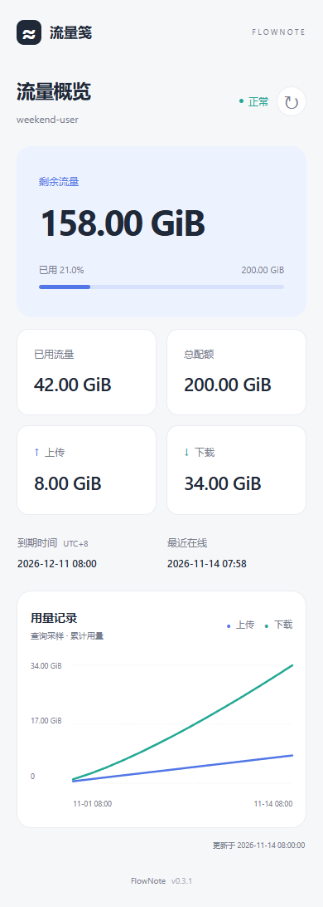
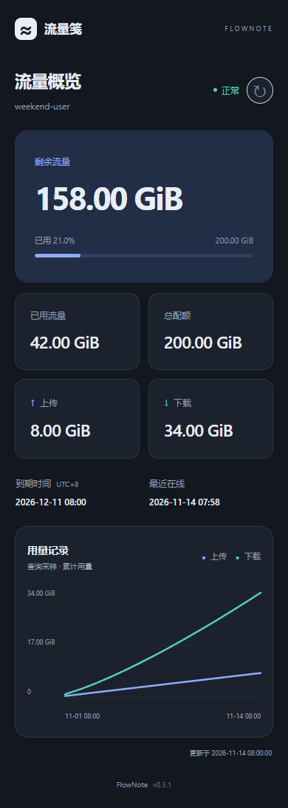
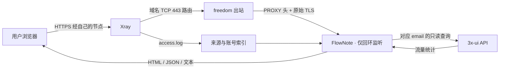

<div align="center">


# FlowNote · 流量笺

**连接你的节点，打开一个链接，流量与有效期一目了然。**

面向 3x-ui 拼节点用户的轻量流量查询页。无需开启面板订阅，无需用户登录。

[](https://github.com/youbilin/FlowNote/actions/workflows/ci.yml)
[](CHANGELOG.md)
[](Cargo.toml)
[](LICENSE)

**简体中文** · [English](README.en.md)

[界面预览](#界面预览) · [快速开始](#快速开始) · [部署指南](docs/DEPLOYMENT.md) · [设计文档](docs/DESIGN.md) · [反馈问题](https://github.com/youbilin/FlowNote/issues)

</div>

---

## 为什么做 FlowNote

“还剩多少流量？什么时候到期？”对于共用一台服务器、分别拥有独立账号的用户，这两个问题不应该需要进入管理面板，也不应该要求把账号凭据交给一个查询网站。

FlowNote 提供一张只读的流量手记：用户先连接管理员分配的节点，再打开专用 HTTPS 链接。服务通过 Xray 的连接来源与访问日志关联当前账号，从面板读取对应统计，展示剩余流量、配额与有效期。**不依赖面板订阅功能，也不需要在页面填写账号、UUID 或订阅链接。**

> [!IMPORTANT]
> **v0.3 为早期版本，上线前需要真实双账号验收。** 来源与日志的关联依赖部署拓扑，不支持 Mux、CDN 或多个账号共享底层连接的场景。已通过本地模拟集成测试，尚未完成真实 3x-ui / Xray 环境验证。详见[支持范围](#支持范围)和[安全边界](docs/DESIGN.md#2-数据链路与身份边界)。

## 界面预览

<p align="center">
  
</p>

<details>
<summary><strong>查看手机、深色模式与错误页</strong></summary>
<br />
<table>
<tr>
<td align="center" width="33%"><strong>手机浅色</strong><br /></td>
<td align="center" width="33%"><strong>手机深色</strong><br /></td>
<td align="center" width="33%"><strong>无法识别时</strong><br /></td>
</tr>
</table>
</details>

*截图和日期曲线使用合成账号与流量数据；实际曲线从启用采样后逐步积累。查询页没有第三方资源；GitHub 文档中的徽章由 GitHub / Shields.io 提供。*

## 功能一览

| 能力 | 说明 |
| --- | --- |
| 看清余量 | 剩余、已用、总配额、上传、下载，以及直观的用量进度 |
| 日期曲线 | 可选保存查询时的累计上传 / 下载，按实际时间绘制；不回填历史、不冒充每日账单 |
| 便捷安装 | Linux amd64 / arm64 静态安装包、校验清单和安装脚本；首次启动前配置域名与面板 |
| 看清有效期 | 到期时间、时区、最近在线；正确区分无限套餐与首次使用计时 |
| 状态有反馈 | 正常、低流量、用尽、过期、停用及友好错误页 |
| HTTPS 入口 | 自有域名与证书，原生 TLS，核对 SNI / Host |
| 少一步操作 | 用户无需登录、无需启用面板订阅；管理员配置面板 API Token |
| 适配日常使用 | 手机与桌面响应式布局、系统深色模式、键盘焦点 |
| 输出可组合 | HTML、纯文本和 JSON；提供 `GET` / `HEAD` |
| 克制的前端 | 服务端渲染，无 JavaScript、无外部字体、无统计脚本、无浏览器存储 |
| 有界服务 | 并发与超时限制、短期缓存、响应大小限制；已观察到来源冲突时拒绝返回数据 |

## 快速开始

### 先确认这四件事

- **同机部署**：Linux 上的 FlowNote 与 Xray 位于同一主机、同一网络命名空间。
- **面板接口**：你的 3x-ui 支持 API Token 与 `/panel/api/clients/traffic/{email}`。无需开启订阅；不兼容旧版 Cookie 登录。
- **域名证书**：准备自有查询子域名及有效证书，建议使用 DNS-01 续期，不套 CDN。
- **来源可关联**：查询域名经过对应节点，开启 access log，禁用该场景的 Mux，并完成双账号实测。

### 1. 安装（Linux amd64 / arm64）

在有 systemd 的服务器上执行，安装时自动识别架构，无需 Rust：

```bash
curl --proto '=https' --tlsv1.2 -fsSL https://github.com/youbilin/FlowNote/releases/download/v0.3.1/install.sh | sudo bash -s -- --version v0.3.1
```

脚本从固定版本 Release 下载静态 musl 包，核对 SHA-256、包内路径与二进制版本，创建服务用户并安装 systemd 单元。**已有配置、Token 和证书会保留；首次安装完成后仍需填写下面的接入配置。** 已运行的服务会在升级时重启，旧二进制留作回退。

希望先审阅脚本，或只下载离线安装包：

```bash
curl --proto '=https' --tlsv1.2 -fsSL -o install.sh https://github.com/youbilin/FlowNote/releases/download/v0.3.1/install.sh
less install.sh
sudo bash install.sh --version v0.3.1
# 仅下载并校验，不修改系统：
bash install.sh --version v0.3.1 --download-only ./flownote-download
```

[预编译包与 SHA256SUMS](https://github.com/youbilin/FlowNote/releases/tag/v0.3.1) · [安装与升级细节](docs/DEPLOYMENT.md#安装包与安装脚本)

<details>
<summary>从源码构建</summary>

```bash
git clone https://github.com/youbilin/FlowNote.git
cd FlowNote
cargo build --release --locked
```

需要 Rust 工具链和 C 编译工具；服务配置见部署指南。

</details>

### 2. 配置与接入

从 [`deploy/config.example.toml`](deploy/config.example.toml) 开始，设置查询域名、证书完整链、私钥、Xray access log 和面板 API Token。按[部署指南](docs/DEPLOYMENT.md#部署)创建专用服务用户，并合并 [Xray 配置片段](deploy/xray-snippet.json)。

先验证面板连通性，命令执行后退出，不启动查询监听：

```bash
sudo -u flownote /usr/local/bin/flownote /etc/flownote/config.toml   --check-panel '真实的-client-email'
```

安装并启动 [`flownote.service`](deploy/flownote.service) 后，完成[双账号上线验收](docs/DEPLOYMENT.md#6-双账号上线验收必须)，再将查询链接交给用户。

### 3. 连接节点，打开查询页

```text
https://traffic.你的域名/
```

浏览器显示网页。终端也可读取文本或 JSON，请确保请求经过对应代理；下方域名和本地代理端口均为示例：

```bash
curl --proxy socks5h://127.0.0.1:1080 https://traffic.example.com/
curl --proxy socks5h://127.0.0.1:1080 https://traffic.example.com/json
```

### 只想先看看界面？

```bash
cargo run --locked -- --preview output/preview
```

直接打开 `output/preview/index.html` 即可查看。命令生成正常、低流量、用尽、过期、停用、不限、未激活、403、502 共九种合成页面，**不需要配置、令牌、证书或真实面板，也不会启动服务**。

## 它如何工作



FlowNote 先读取 PROXY 头，再完成 TLS 握手；通过服务端日志关联账号，并检查面板返回的 email 是否一致。客户端参数、`X-Forwarded-For` 或 Cookie 不能用于选择要查询的账号。

**8686 只监听回环地址，不应开放公网、做 DNAT 或放到普通 HTTP 反向代理后面。** 本机不可信进程仍可能伪造 PROXY 头；详细信任模型见[架构与安全设计](docs/DESIGN.md)。

## 支持范围

| 场景 | v0.3 状态 |
| --- | --- |
| 单 VPS、同机 Xray、非复用连接 | 目标部署方式；仍需实机验收 |
| IPv4 / IPv6 与 PROXY v1 / v2 | 已有解析与单元测试覆盖 |
| API Token 面板 | 必需，接口权限由实际面板版本决定 |
| 面板订阅关闭 | 支持，不依赖订阅接口 |
| Mux、CDN、多账号共享来源 | 不支持，可能导致身份关联不唯一 |
| 远程面板 | 仅允许证书正常验证的 HTTPS；回环面板可 HTTP |
| 账号已停用或超限，Xray 拒绝连接 | 无法保证查询页仍可访问 |
| 多 VPS 汇总、分组、主动提醒 | 不在本项目当前范围 |

版本直接从原型 v0.1 推进至 v0.3；跳过 v0.2，不规划 v0.4。当前重点是把单机、自助、只读查询做好。

## 验证与贡献

```bash
cargo fmt --check
cargo clippy --locked -- -D warnings
cargo test --locked
cargo build --locked
python3 tests/e2e.py target/debug/flownote
```

本地记录：**33 个单元测试、35 项 TLS / PROXY 集成检查、8 组安装脚本检查通过**；Playwright 检查桌面、手机、深色与错误状态。集成测试使用本机临时证书、模拟面板与日志，不替代真实 3x-ui / Xray 验收。CI 状态以页首的实际运行结果为准。

欢迎提交可复现的问题、文档改进与小范围修复。开始前请阅读[贡献指南](CONTRIBUTING.md)；涉及身份关联或数据泄露的问题，请按[安全报告指引](SECURITY.md)私下报告，不要公开上传真实 token、访问日志或用户数据。

## 文档导航

| 文档 | 内容 |
| --- | --- |
| [部署指南](docs/DEPLOYMENT.md) | 域名、证书、权限、分流、systemd、验收和故障排查 |
| [架构设计](docs/DESIGN.md) | 身份关联、TLS、信任边界与资源预算 |
| [UI 设计](docs/UI.md) | 信息层级、视觉规范、状态与交互 |
| [测试记录](docs/TESTING.md) | 本地验证结果及尚未验证的内容 |
| [更新记录](CHANGELOG.md) | 版本变更与迁移范围 |

## 许可证

[MIT](LICENSE) © 2026 You Bilin。FlowNote 是独立项目，与 3x-ui / Xray 官方无隶属关系。
